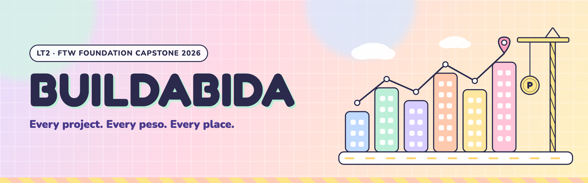

<p align="center">
  
</p>

# Infrastructure Project Monitoring

A Databricks pipeline that shows where Philippine public infrastructure money goes and what it builds. It also highlights places receiving relatively little for their population and flood risk.

[](https://github.com/Buildabida/infra-project-monitoring/actions/workflows/checks.yml)

Team Buildabida built it for the 2026 FTW Foundation Data Engineering Track capstone.

## Why we built it

Government project data is spread across several sources, and each one names places and project types differently. That makes the full investment picture hard to see.

Our brief asks:

> Where is government infrastructure investment concentrated, and what types of projects are being funded?
> Which areas have relatively low investment compared with population and infrastructure needs?

The [dashboard](dashboard/README.md) answers one business question: **How can DPWH better monitor where its infrastructure investments go?** It has an overview and one tab for each analytics question:

1. **Where is the money going?** Which regions get the most budget over the project years, and how well each region finishes its projects.
2. **What are we building?** Which project types get the money, where they are built, how long they usually take, and how they do in flood-risk areas.
3. **Who are we leaving behind?** Which places get relatively little compared with their population and flood risk.

The Analytics views behind it each answer one insight:

1. Where does the money go?
2. Are investments proportional to population?
3. Do flood-control investments overlap with flood-prone areas?
4. Which projects need a closer look?
5. Are we seeing projects or a connected infrastructure network?
6. What can we see only after connecting the datasets?

## Who it is for

- **People** checking public works investment in their region or province
- **Planners** looking for places with high needs and relatively low investment
- **Reviewers** checking the pipeline, the evidence, and our assumptions

## Data we use

Six approved source snapshots, loaded from Cloudflare R2:

| Source | What we use it for |
| --- | --- |
| [DPWH projects API](https://api.dpwh.bettergov.ph/projects) by BetterGov.ph | DPWH projects with reported budget, progress, dates, contractor, and map points. The selected snapshot has 265,661 rows. |
| [BetterGov flood-control projects](https://bettergov.ph/flood-control-projects/table) | The flood-control list named in the brief. The selected snapshot has 9,861 rows. |
| [PSGC 2Q 2026](https://psa.gov.ph/classification/psgc) by PSA | Official geographic codes and names. Its population is only a cross-check. |
| [2024 Census of Population](https://psa.gov.ph/content/2024-census-population-popcen-population-counts-declared-official-president) by PSA | Table C is our authoritative population source. |
| [Boundary maps](https://github.com/bendlikeabamboo/barangay-boundaries-repository) with PSGC codes | Shapes for matching project points to places |
| [DENR MGB flood susceptibility](https://controlmap.mgb.gov.ph/arcgis/rest/services/GeospatialDataInventory/GDI_Detailed_Flood_Susceptibility/FeatureServer/0) | Flood-hazard areas, from an approved trimmed extract |

We also check samples by hand against the [DPWH Transparency Portal](https://transparency.dpwh.gov.ph) and [Sumbong sa Pangulo](https://sumbongsapangulo.ph). They are not loaded.

Three source rules matter:

- The API field `location.province` can hold a DPWH district office name, not a real province. Silver uses map points and boundaries instead.
- One flood-control contract can have several real rows, like components or funding years. Bronze keeps them all, and Silver decides how to read them.
- A project can be in both project lists. Silver matches them by exact Contract ID, so nothing is counted twice.

Provenance and file details: [Bronze R2 architecture](docs/bronze/bronze_r2_architecture.md#six-sources-and-provenance).

## How it works

```mermaid
flowchart LR
    S["Source<br>six CSV snapshots"]:::src --> B["Bronze"]:::bronze --> BV{{"Bronze checks"}}:::val
    BV --> SV["Silver"]:::silver --> SVV{{"Silver checks"}}:::val
    SVV --> G["Gold"]:::gold --> GV{{"Gold checks"}}:::val
    GV --> A["Analytics"]:::gold --> AV{{"Analytics checks"}}:::val
    AV --> Q{{"End-to-end<br>quality gate"}}:::val --> D["Dashboard"]:::dash
    classDef src fill:#D7E8FF,stroke:#2B2A4C,color:#2B2A4C
    classDef bronze fill:#FFDCC8,stroke:#2B2A4C,color:#2B2A4C
    classDef silver fill:#D2F4E4,stroke:#2B2A4C,color:#2B2A4C
    classDef gold fill:#FFF2BF,stroke:#2B2A4C,color:#2B2A4C
    classDef val fill:#E6DDFF,stroke:#2B2A4C,color:#2B2A4C
    classDef dash fill:#FFD9E6,stroke:#2B2A4C,color:#2B2A4C
```



Each layer is a schema in the `buildabida-capstone` catalog:

| Schema | What it holds | Who owns what |
| --- | --- | --- |
| `00-source` | The R2 snapshots, through a Unity Catalog volume | Raw files, never changed |
| `01-bronze` | One selected snapshot per source, with lineage | Loading as-is, row counts, snapshot IDs, `load_log` |
| `02-silver` | Cleaned, standardized, and matched data | Cleaning, mappings, population reconciliation, place and flood matching |
| `03-gold` | Facts and dimensions | Grain, deterministic keys, business measures |
| `04-validation` | Every check result | Evidence from each validator, and the end-to-end gate |
| `05-analytics` | Analytics views, one per insight | What the dashboard reads |

Each layer runs only after the layer before it passes its checks. Checks are **STOP** (blocks the next step) or **FLAG** (a known data limit that stays visible). Every validator saves its results before it decides, so a failure stays readable. The [end-to-end quality gate](notebooks/06_data_quality/README.md) then confirms that every validator passed for this run and that the layers agree. Only after that does the dashboard refresh.

One [Databricks job](resources/README.md) runs it all as 50 tasks, in dependency order.

## Data model

Gold is a star schema with four facts that share dimensions. They share region, reporting area, flood level, and date, so they form a constellation.

| Fact | One row per | Main measures |
| --- | --- | --- |
| `fact_project_snapshot` | DPWH project per source snapshot | Reported budget, physical progress, delivery flags |
| `fact_region_population` | Region per population year and source | Population |
| `fact_province_reporting_area_population` | Reporting area per population year, source, and run | Population |
| `fact_region_flood_exposure` | Region per flood level, MGB snapshot, and boundary version | Flood area, share of region area |

The dimensions are `dim_project`, `dim_project_status`, `dim_date` (used for three roles), `dim_region`, `dim_province_reporting_area`, `dim_flood_susceptibility`, and two boundary tables.

- Keys are deterministic, so a rerun never changes them (D-33).
- Key `0` holds Central Office, unmatched, and unresolved records, so nothing is dropped.
- Every fact keeps `source_snapshot_id` and `run_id` (D-29).

The full columns, keys, and relationships are in the [Gold model](docs/model/gold_model.md). The diagram is in the [data model](docs/model/data-model.md).

## Quickstart

We write code in VS Code and run it in the shared [Databricks Free Edition](https://www.databricks.com/learn/free-edition) workspace. Nadine manages workspace access.

1. Install VS Code with the **Databricks** and **Python** extensions, and the [Databricks CLI](https://docs.databricks.com/aws/en/dev-tools/cli/install) 0.278.0 or later.
2. Clone `https://github.com/Buildabida/infra-project-monitoring.git` and open the folder.
3. In the **Databricks** extension, sign in with **OAuth (user to machine)** and pick **Serverless**.
4. Open `notebooks/00_setup/00_setup_workspace.sql`, then select **Run on Databricks**, then **Run File as Workflow**. The last cells list the schemas and the source volume.
5. Run `notebooks/00_setup/01_check_sources.py` the same way. All six sources should be `OK`.

Full steps: [set up VS Code](docs/guides/vscode-setup.md). Testing from a brand-new workspace: [clean-workspace test](docs/guides/clean_workspace_test.md).

## Run the pipeline

Deploy your own copy of the job, then run it:

```bash
databricks bundle validate -t dev
databricks bundle deploy -t dev
databricks bundle run -t dev buildabida_full_pipeline
```

Your copy is named `[dev <your name>]`, so it never touches the team job. A full run uses a large part of the workspace's daily quota, so run it only when you need to. Merges to `main` deploy the team job automatically, but never run it. Details are in [resources](resources/README.md) and the [operations guide](docs/guides/operations.md).

To run notebooks one at a time, follow the [full run order](notebooks/README.md#d-57-production-rerun-order).

## Check the results

After a run, the gate summary tells you whether the data is safe to publish:

```sql
SELECT layer, gate_status, passed_checks, flagged_checks, failed_stop_checks, missing_checks, failure_reason
FROM `buildabida-capstone`.`04-validation`.quality_gate_summary
ORDER BY evaluated_at DESC, layer
LIMIT 6;
```

The `ALL` row must be `PASS` or `FLAG`. `FLAG` means known data limits, listed below. If it says `STOP`, read `failure_reason` and follow [recover from a failure](docs/guides/operations.md#recover-from-a-failure). Each layer's checks are explained in [data-quality checks](docs/validation/validation.md).

## Results so far

Every layer is implemented. Bronze loads all six sources, and Silver cleans, maps, and matches them. The six Gold dimensions are implemented, plus the two province reporting-area dimensions from D-57 and all four facts. The Analytics views and the dashboard read them.

On October 16, 2026, the full 49-task job ran in Databricks job run `1077732256280159`. Every task succeeded after a repair:

- 159 province and Analytics checks were saved, with no failed STOP check.
- 75.3267 percent of projects and 83.6904 percent of reported budget are mapped to a province reporting area.
- A second run on the same Gold data changed none of the Analytics checks.

See the [Analytics evidence](docs/evidence/analytics-2026-10-16/README.md).

The 50-task job with the end-to-end gate first ran on October 19, 2026, in job run `457335378856032`. After a repair it passed with no failed STOP check, and Silver, Gold, and Analytics agree on 265,582 projects and their reported budget. See the [end-to-end gate evidence](docs/evidence/end-to-end-gate-2026-10-19/README.md). A second run on unchanged data, job run `880939659105900`, gave the same gate result and totals.

On October 21, 2026, the Asset Bundle development target was also deployed in
a separate Free Edition workspace. Its two complete job runs,
`702857652434494` and `937376856057683`, both succeeded from setup through the
dashboard. They used the same source snapshot and produced the same gate
counts: 566 pass, 109 flag, 0 failed STOP, and 0 missing. See the
[dev-bundle and clean-workspace evidence](docs/evidence/dev-bundle-2026-10-21/README.md).

## Known limits

- **Budget is not payment.** We report the reported project or contract budget. The source has no usable payment data, so we never show disbursement (D-28).
- **Missing is not zero.** About one in five DPWH projects has no map point, so it has no place or flood level. A place with no mapped projects may be a data gap, not zero investment. BARMM coverage is limited by the source, so it is never ranked.
- **Few project points fall in MGB flood areas.** In the first project-flood run, 20,398 of 215,138 projects with usable points got a flood level. Most of the rest fall outside every approved polygon. That is **not** evidence of low flood risk. See [project flood mapping](docs/silver/silver_project_flood_mapping.md#runtime-evidence).
- **MGB ratings have gaps.** The snapshot has 1,838 missing or unrated records, including 1,815 with no rating and no geometry. They stay as non-blocking findings. Bronze keeps the raw values.
- **Province flood exposure is deferred.** Flood area is regional only, until the province intersection is shown to be safe and affordable on Free Edition (D-57).
- **One snapshot, no history.** Gold holds one DPWH snapshot. `infra_year` is a project cohort, not a year of spending.
- **Source provenance varies.** Several CSVs were made from API JSON, XLSX, or GeoJSON, and we can't prove every export was lossless.
- **One workspace runs the final pipeline** ([D-01](docs/decisions.md)), to save compute.

## Find your way around

```text
.
├── README.md              this page
├── CONTRIBUTING.md        how we work, reviews, and AI rules
├── databricks.yml         bundle: dev and prod targets
├── resources/             the Databricks job
├── notebooks/
│   ├── 00_setup/          workspace and source checks
│   ├── 01_bronze/         load the six sources as-is
│   ├── 02_silver/         clean, map, and match
│   ├── 03_gold/           facts and dimensions
│   ├── 04_validation/     one validator per layer step
│   ├── 05_analytics/      the Analytics views
│   └── 06_data_quality/   the end-to-end quality gate
├── src/                   shared Python for Bronze
├── tests/                 automated tests
├── dashboard/             dashboard export and spec
├── docs/                  model, checks, decisions, operations, evidence, history
├── assets/                repository images
└── .github/               CI/CD, CODEOWNERS, issue and PR forms
```

| I want to | Read |
| --- | --- |
| Run or monitor the pipeline | [Operations guide](docs/guides/operations.md), [notebooks guide](notebooks/README.md) |
| Understand a table | [Gold model](docs/model/gold_model.md), [data model](docs/model/data-model.md), [Analytics views](notebooks/05_analytics/README.md) |
| Understand a check | [Data-quality checks](docs/validation/validation.md), [quality gate](notebooks/06_data_quality/README.md) |
| Know why we chose something | [Decisions](docs/decisions.md) |
| Find every other doc | [Docs index](docs/README.md) |

## Province reporting areas

D-57 adds a second geography under region: official PSGC provinces, independent cities with no province parent, NCR as one area, and Unknown key `0`. Silver assigns each project once, mostly by its map point inside one province boundary. The DPWH `location.province` field is only evidence. Region stays the parent and the level we reconcile against. Never add region and province numbers together. See the [province reporting readiness](docs/silver/province_reporting_readiness.md) and [Silver mapping](docs/silver/silver_project_province_mapping.md).

## Help out

Every change goes through a pull request with one review and the [code owners](.github/CODEOWNERS). Read [how we work](CONTRIBUTING.md) first. Our AI policy is AI-assisted and human-owned. See [using AI tools](CONTRIBUTING.md#using-ai-tools).

## Team and timeline

Team members are Kinah, Bri, Nadine, Sam, and Tricia. Carmi is the mentor, and Simonee is the support instructor.

| Date | Milestone |
| --- | --- |
| Oct 3 | Bronze ingestion and reviewed draft schema |
| Oct 10 | Silver and Gold tables with validation |
| Oct 17 | Dashboard |
| Oct 24 | Final Capstone Showcase and graduation |

Tasks are tracked on the [project board](https://github.com/orgs/Buildabida/projects/1).

## License and credits

Project code uses the [MIT License](LICENSE). Source data stays under each publisher's terms. We thank DPWH, PSA, BetterGov.ph, OCHA HDX, and FTW Foundation.
