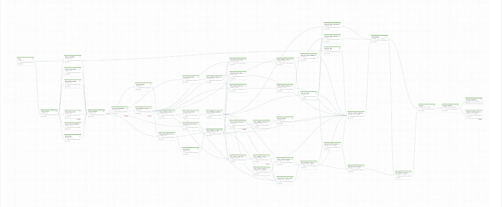
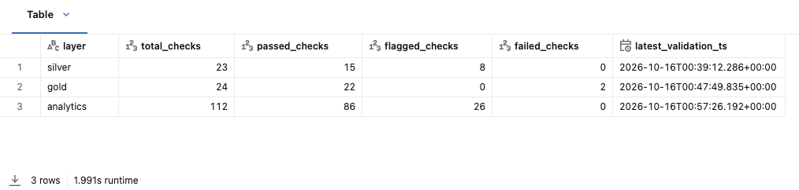
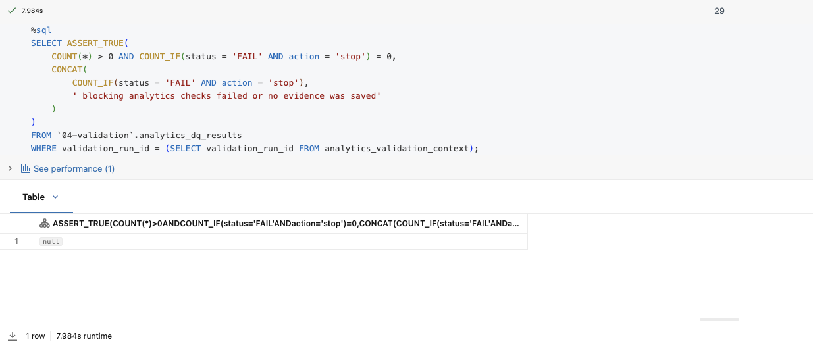
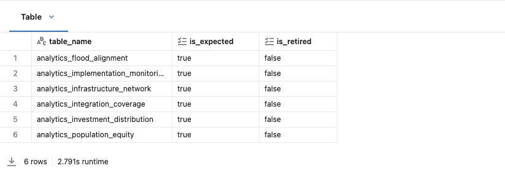
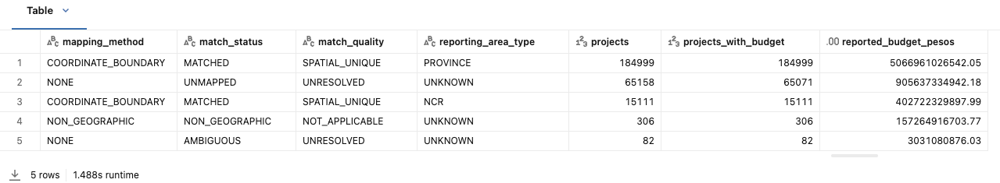
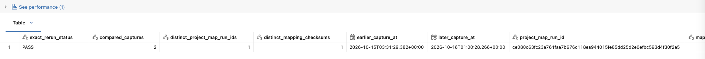

# Analytics and D-57 province runtime evidence

## Scope

This report records the first Databricks run of the D-56 (proposed) Analytics views with the
D-57 province reporting area. It covers the Silver and Gold province validators under rule version
v2, the Analytics views, `10_validation_analytics` under `analytics-validation-v4`, and the acceptance
publisher.

The run used Databricks Serverless (environment version 6) in the `buildabida-capstone` catalog on
October 16, 2026. The full job [`buildabida-full-pipeline`](../../../resources/buildabida_full_pipeline.job.yml)
ran all 49 tasks from Setup to the acceptance publisher.

| Item | Value |
| --- | --- |
| Job ID | `377977871315672` |
| Job run ID | `1077732256280159` (Repair 2, the latest attempt, succeeded) |
| DPWH snapshot ID | `metadata-6321c7aa6f2a14e12f4c` |
| Snapshot date | `2026-10-04` |
| Silver validation run (`03b`) | `88cc23e4706bc024172eaa9fe86a98af01464e0ef8808e2fa632731ed33e0978` |
| Gold validation run (`09a`) | `5a863b35c04a16aba4c76bbe652a69c927f61c26652d672c1ce419c3ea275f4e` |
| Analytics validation run (`10`) | `2b0558751cb722b38b61b16d97a4f974318b36a939232af669defc59d555e933` |
| Gold `fact_project_snapshot` run | `1ec370b8e681d429bacc6b6125aeb54c88525c0bbd9cf611bacd32f5fe05ba27` |
| Project-map run | `ce080c63fc23a761faa7b676c118ea944015fe85dd25d2e0efbc593d4f30f2a5` |
| Silver checks saved | `2026-10-16T00:39:12Z` |
| Gold checks saved | `2026-10-16T00:47:49Z` |
| Analytics checks saved | `2026-10-16T00:57:26Z` |

## Job task graph

All 49 tasks of the job succeeded. The task graph shows that every layer waits for its validation
gate: Silver waits for Bronze validation, Gold waits for the Silver validators, the Analytics views wait
for both Gold validators, and the evidence publisher and the dashboard refresh wait for
`10_validation_analytics`.

| Task list | Image |
| --- | --- |
| Setup to the province population fact | [Task list, part 1](images/07-job-task-list-part-1.webp) |
| Silver flood-control components to the evidence publisher | [Task list, part 2](images/08-job-task-list-part-2.webp) |

The longest tasks were `silver_region_flood_exposure` (28m 32s), `silver_validation_project_flood_map`
(16m 13s), `silver_validation_projects` (12m 19s), and `10_validation_analytics` (11m 10s). The
dashboard refresh took 3m 56s.

## Runtime fixes found by this run

The first attempts stopped on four Databricks SQL errors. They were fixed in the workspace and then
ported into the repository with tests.

| Notebook | Error | Fix |
| --- | --- | --- |
| `02_silver/01a_silver_province_reporting_area` | `psgc_version` and `psgc_run_id` were ambiguous after the join | Qualify them as `all_areas.` |
| `02_silver/08c_silver_project_province_map` | `project_key` was ambiguous in the grain check | Qualify it as `map.project_key` |
| `03_gold/01a_gold_dim_province_reporting_area` | The boundary `MERGE` did not keep the SRID of the target column | Merge from a subquery that applies `ST_SETSRID(boundary_geometry, 4326)` |
| `03_gold/07_gold_fact_project_snapshot` | `''` inside the dynamic `ALTER TABLE` string is not an escaped quote in Spark SQL | Use `\'` inside the string |

The run also showed one labeling bug. `09a` saved its two FLAG checks with status `FAIL` and action
`flag`. The STOP gate counts only `stop` rows, so the run was not blocked, and both rows are
coverage findings, not failures. `09a` now saves them as `FLAG`, the same rule as `03b`. The CSV in
this folder keeps the rows exactly as they were saved.

## Acceptance result

| Layer | Checks | STOP PASS | FLAG with findings | FLAG PASS | Blocking failures |
| --- | ---: | ---: | ---: | ---: | ---: |
| Silver (`03b`, v2) | 23 | 14 | 8 | 1 | 0 |
| Gold (`09a`, v2) | 24 | 22 | 2, saved as `FAIL` | 0 | 0 |
| Analytics (`10`, v4) | 112 | 84 | 26 | 2 | 0 |
| **Total** | **159** | **120** | **36** | **3** | **0** |

Every STOP check passed. Analytics matches the expected contract of 84 STOP and 28 FLAG checks.
The publisher's own gate passed: no `stop` row failed across the three layers.

## Analytics views only

`05-analytics` held exactly the D-56 Analytics views, with no retired view and no
`analytics_region_project_progress`.

| View | Compared rows | Breaks |
| --- | ---: | ---: |
| `analytics_investment_distribution` | 1,001 (190 region, 811 reporting area) | 0 |
| `analytics_population_equity` | 101 reporting areas | 0 |
| `analytics_flood_alignment` | 144 (18 regions × 8 classes) | 0 |
| `analytics_implementation_monitoring` | 265,656 projects | 0 |
| `analytics_infrastructure_network` | 265,656 projects | 0 |
| `analytics_integration_coverage` | 22 link and outcome totals | 0 |

Each view was rebuilt from Gold with separate SQL and compared row by row.

## Province mapping and coverage

| Mapping outcome | Type | Projects | Projects with budget | Reported budget |
| --- | --- | ---: | ---: | ---: |
| Unique coordinate boundary | Province | 184,999 | 184,999 | PHP 5,066,961,026,542.05 |
| Unique coordinate boundary | NCR | 15,111 | 15,111 | PHP 402,722,329,897.99 |
| Unmapped | Unknown | 65,158 | 65,071 | PHP 905,637,334,942.18 |
| Non-geographic | Unknown | 306 | 306 | PHP 157,264,916,703.77 |
| Ambiguous | Unknown | 82 | 82 | PHP 3,031,080,876.03 |

| Coverage | Projects | Reported budget |
| --- | ---: | ---: |
| Linked to a reporting area | 200,110 of 265,656 (75.33%) | PHP 5,469,683,356,440.04 |
| Not linked to a reporting area | 65,546 | PHP 1,065,933,332,521.98 |
| Linked to an official region | 265,084 | PHP 6,378,351,772,243.23 |
| Region and reporting area agree | 197,401 | PHP 5,389,989,138,755.34 |

The mapping outcomes and coverage are the same as the October 15 run.

## Reporting-area members

The dimension has 101 geographic reporting areas plus Unknown. In view 1:

| Coverage status | Reporting areas | Regions |
| --- | ---: | ---: |
| `REPORTED` | 74 | 17 |
| `NO_MAPPED_PROJECT_DATA` | 22 | 1 (BARMM) |
| `LIMITED_SOURCE_COVERAGE` | 5 | 0 |

- The 22 areas without mapped projects are the 18 independent cities and Negros Occidental, Negros
  Oriental, Siquijor, and Sulu. None of them has a compatible selected boundary.
- The 5 limited areas are the BARMM provinces that do have mapped projects: Basilan, Lanao del Sur,
  Maguindanao del Norte, Maguindanao del Sur, and Tawi-Tawi.
- BARMM has no mapped project at region level, because no DPWH region name maps to it. Its provinces
  do have projects through coordinates. Both levels mark BARMM and never rank it.

View 2 compares 74 reporting areas. The other 27 are `EXCLUDED_SOURCE_COVERAGE` and show no share,
gap, ratio, or per-capita value.

## Region and province disagreement

| Finding | Projects |
| --- | ---: |
| Region differs from the parent region of the reporting area | 2,709 |
| Official region but no reporting area | 64,974 |
| Region key `0` | 572 |

Region comes from the DPWH region name (D-31) and the reporting area from coordinates. The two are
kept as published and flagged. Neither is overwritten.

## Population

| Metric | Value |
| --- | ---: |
| Accepted-primary population | 112,348,732 |
| Accepted population on reporting area key `0` | 214,703 |
| Regions with accepted population on key `0` | 1 of 18 |
| Table C population excluded before aggregation | 113,088,493 of 225,437,225 |

The new v2 STOP checks passed in Silver and Gold: each contributing Table C row is counted once,
reporting-area population equals region population, no region has more reporting-area population
than its own total, and region minus reporting-area population equals the population on key `0`.

The excluded figure sums the positive population of Table C rows that look like barangays
(`APPROVED_UPPERCASE_BARANGAY` or `NORMAL_BARANGAY_CANDIDATE`) but are not `ACCEPTED_PRIMARY`. It
never enters the fact. It is the same value as on October 15. This run does not show which rows make
it up. It is about the size of the accepted total, so review it in
`02-silver.silver_population_place_reconciliation` before quoting it as people left out.

## Rerun evidence

| Check | Result |
| --- | --- |
| Province map exact rerun | `PASS`. Two captures, `2026-10-15T03:31:29Z` and `2026-10-16T01:00:28Z`, kept one project-map run ID and one mapping checksum. |
| Analytics rerun stability, first run | `PASS` with 0 compared checks. This was the first run of this validation run ID, so nothing was saved to compare yet. |
| Analytics rerun stability, second run | `PASS`. `10_validation_analytics` ran again on the same Gold data from `2026-10-16T02:49Z` to `03:03Z`, under the same validation run ID. It compared 111 saved checks and none changed. |

The second run saved the same 112 results: 84 STOP checks passed, 26 FLAG checks reported findings,
and 2 FLAG checks passed. Every check has the same failed and total rows as the first run, except the
rerun check itself, which compared 0 checks the first time and 111 the second. The Analytics views are
stable on unchanged Gold data.

## Files

| File | Content |
| --- | --- |
| [`validation-results-2026-10-16.csv`](validation-results-2026-10-16.csv) | All 159 Silver, Gold, and Analytics check rows from `province_reporting_acceptance_evidence` |
| [`investment-distribution-compare-2026-10-16.csv`](investment-distribution-compare-2026-10-16.csv) | View 1 row-by-row comparison |
| [`population-equity-compare-2026-10-16.csv`](population-equity-compare-2026-10-16.csv) | View 2 row-by-row comparison |
| [`flood-alignment-compare-2026-10-16.csv`](flood-alignment-compare-2026-10-16.csv) | View 3 row-by-row comparison |
| [`integration-link-totals-2026-10-16.csv`](integration-link-totals-2026-10-16.csv) | View 6 linked and unlinked totals per link |
| [`validation-results-rerun-2026-10-16.csv`](validation-results-rerun-2026-10-16.csv) | All 112 Analytics check rows from the second run of `10_validation_analytics` |

## Limits

This evidence covers source snapshot `metadata-6321c7aa6f2a14e12f4c` and the rule versions above.
It does not approve D-56, which stays proposed until the team approves it. It does not claim
complete geographic coverage or province flood exposure, which stays deferred. A changed snapshot,
PSGC, boundary, configuration, or rule version needs new evidence.
