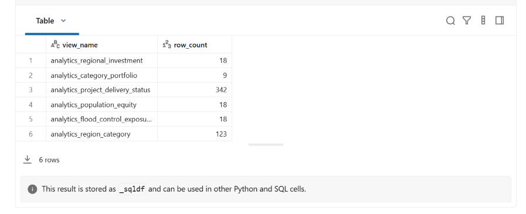
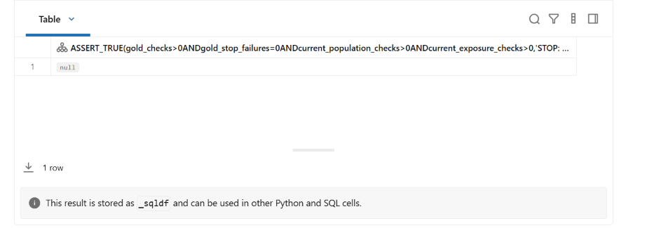
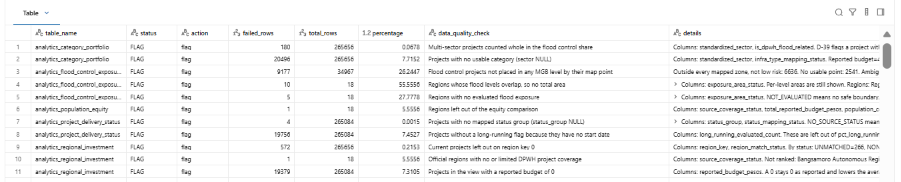
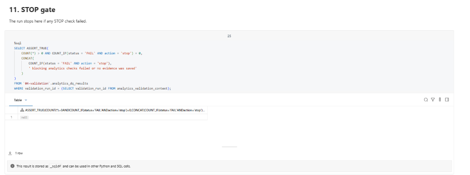
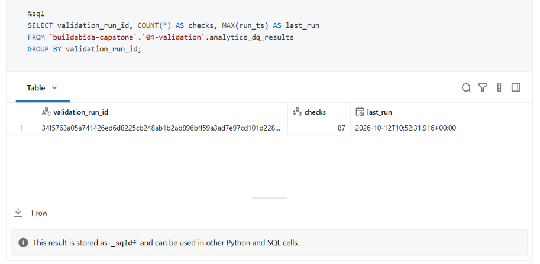
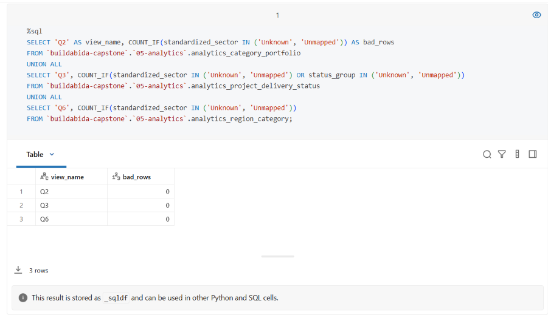

# Analytics views validation evidence

## Scope

This report records Databricks evidence for the six analytics views from issue #126.
The views answer business questions Q1 to Q6 for the dashboard (#20) and Genie (#21).

The evidence covers:

- building the six views in `05-analytics`
- the Gold gate before validation
- 87 checks that rebuild each view from Gold and compare it row by row
- a rerun that updates the same evidence rows

The evidence was captured on October 12, 2026 in the `buildabida-capstone` Unity Catalog.
Both notebooks ran interactively on Databricks serverless, from the synced dev bundle.
The workflow run was cancelled after more than 10 minutes in the job queue.

Both notebooks ran on two versions of Gold: first on Gold from before #125, then again after #125 merged.
The results after #125 are the final evidence.

## Run identity

### After #125 (final)

| Item | Value |
| --- | --- |
| Validation run ID | `e14864fd46d3fe4e27be90cd9dc4b1cba31fb55d69e7a8149a35834cac56297f` |
| Views built | `2026-10-12T14:12Z` (`2026-10-12 22:12` Asia/Manila) |
| Evidence saved, second run | `2026-10-12T14:24:14.122Z` (`2026-10-12 22:24:14` Asia/Manila) |
| DPWH snapshot ID | `metadata-6321c7aa6f2a14e12f4c` |
| MGB snapshot ID | `metadata-17bf5e65e1838a2f7be9` |
| Gold `fact_project_snapshot` run ID | `1dc106b9c825034bb2bf258a6145b8773ab2cb745f2d2e54eb515d4ec332cdd2` |
| Gold `dim_region` run ID | `0e4a50bd17f0d38d46c35e1a6f636775e4c12e14c113b34147559209199f7f09` |
| Gold `fact_region_population` run ID | `3f729c6fbda8a4683895658e1577329b3f0497c9aec6a2232456ecc3e9754ecd` |
| Gold `fact_region_flood_exposure` run ID | `a7ba8dcd8bcdd96d343603e6fecf931a7d95bd14ce3d81f9ff55cf942a592863` |
| Gold validation run ID | `02b93e2f6f975a7b1b8b767e0eed4e6a4f8dba76dd9b0498a66762c2f4611bc2` (`gold-validation-v2`) |

Only the project fact run ID changed after #125. The DPWH snapshot stayed the same.

### Before #125

| Item | Value |
| --- | --- |
| Validation run ID | `34f5763a05a741426ed6d8225cb248ab1b2ab896bff59a3ad7e97cd101d22844` |
| Views built | `2026-10-12T10:49Z` (`2026-10-12 18:49` Asia/Manila) |
| Evidence saved | `2026-10-12T10:52:31.916Z` (`2026-10-12 18:52:31` Asia/Manila) |
| Gold `fact_project_snapshot` run ID | `185190695a2153a9cd67c5055a5542993ef7280aadde3f77cf9cf4543b911ac4` |

The other run and snapshot IDs were the same as after #125.

The validation run ID is a hash of the four Gold run IDs and the rule version `analytics-validation-v1`.
The same Gold data always gives the same ID.

## Outcome

Both runs had the same outcome:

- The one-DPWH-snapshot gate passed: current Gold held one snapshot and no empty snapshot ID.
- `01_business_questions` created all six views.
- The Gold gate passed: the latest Gold validation had no failed STOP checks and covered the current population and exposure facts.
- `10_validation_analytics` saved 87 checks: 76 `PASS` and 11 `FLAG`, with zero `FAIL`.
- All 74 checks with action `stop` passed, and the STOP gate passed.
- Two checks with action `flag` found nothing, so they count as `PASS`.
- A second run of the validator gave the same results.

After #125, row counts and totals did not change.
One flag changed: projects with no start date went from 19,756 to 19,762.

The complete machine-readable results are in
[`validation-results-2026-10-12-after-125.csv`](validation-results-2026-10-12-after-125.csv) (final)
and [`validation-results-2026-10-12.csv`](validation-results-2026-10-12.csv) (before #125).

## Views

| View | Question | Rows |
| --- | --- | ---: |
| `analytics_regional_investment` | Q1. Regional investment distribution | 18 |
| `analytics_category_portfolio` | Q2. Infrastructure category portfolio | 9 |
| `analytics_project_delivery_status` | Q3. Project delivery and status | 342 |
| `analytics_population_equity` | Q4. Population-based equity | 18 |
| `analytics_flood_control_exposure` | Q5. Flood control versus flood exposure | 18 |
| `analytics_region_category` | Q6. Investment by area and type | 123 |

## Totals

| Measure | Projects | Reported budget (₱) |
| --- | ---: | ---: |
| Regional views (Q1, Q3, Q6) | 265,084 | 6,378,351,772,243.23 |
| Region key `0` | 572 | 157,264,916,718.79 |
| **All current Gold projects (Q2)** | **265,656** | **6,535,616,688,962.02** |

Q1 plus key `0` equals every current Gold project and the full Gold budget.
No project has a region key missing from `dim_region`.

| View | Share total |
| --- | ---: |
| Q1 budget share | 100.0000 |
| Q2 budget share | 99.9999 |
| Q4 investment share | 100.0000 |
| Q4 population share | 99.9998 |
| Q4 comparable population share | 100.0000 |

Each total is within the rounding tolerance of 0.01.

## Validation flags

The flags keep known data limits visible. They do not change any view.

| View | Check | Finding |
| --- | --- | ---: |
| Q1 | Current projects left out on region key `0` (306 `NON_GEOGRAPHIC`, 266 `UNMATCHED`) | 572 projects |
| Q1 | Projects in the view with a reported budget of 0 | 19,379 projects |
| Q1 | Official regions with no or limited DPWH coverage (BARMM, not ranked) | 1 region |
| Q2 | Projects with no usable category (sector `NULL`, D-37), ₱48,050,146,057.75 | 20,496 projects |
| Q2 | Multi-sector projects counted whole in the broad flood share (D-39), ₱16,367,824,185.17 | 180 projects |
| Q3 | Projects with no mapped status group | 4 projects |
| Q3 | Projects without a long-running flag because they have no start date (19,756 before #125) | 19,762 projects |
| Q4 | Regions left out of the equity comparison (BARMM) | 1 region |
| Q5 | Flood control projects not placed in an MGB level (6,636 outside every zone, 2,541 with no usable point) | 9,177 of 34,967 projects |
| Q5 | Regions whose flood levels overlap, so no total area | 10 regions |
| Q5 | Regions with no evaluated flood exposure | 5 regions |

These flags found nothing:

- Q1: projects in the view without a reported budget
- Q4: official regions without a primary population

## Rerun

After #125, the validator ran twice on the same Gold data.
The second run gave the same 87 results.

`04-validation.analytics_dq_results` then held two validation run IDs, one per version of Gold, with 87 rows each:

| `validation_run_id` | Gold | Checks | Last run |
| --- | --- | ---: | --- |
| `34f5763a…2844` | Before #125 | 87 | `2026-10-12T10:52:31.916Z` |
| `e14864fd…297f` | After #125 | 87 | `2026-10-12T14:24:14.122Z` |

The second run kept 87 rows under its run ID, not 174, so the `MERGE` updated the same rows and did not add copies.
New Gold data gets a new run ID, so the evidence for older Gold stays.
The query result is in [`rerun-evidence-rows-after-125.csv`](rerun-evidence-rows-after-125.csv).

## No placeholder text

No view writes `Unknown` or `Unmapped` in place of a missing sector or status (D-37).
A query of Q2, Q3 and Q6 after the rerun found 0 rows with either value in `standardized_sector` or `status_group`.
It found 0 rows again after #125 ([`no-unknown-text-after-125.csv`](no-unknown-text-after-125.csv)).
Every `NULL` sector or status keeps its reason in `infra_type_mapping_status` or `status_mapping_status`.

## Evidence images

The images are from the run before #125.
The CSV files above hold the results after #125.

### View row counts

### Gold gate

### Saved FLAG rows

### STOP gate

### Evidence rows after the rerun

### Placeholder text query

## Acceptance note

Every blocking check passed on Gold from before and after #125.
Describe the result as **completed with non-blocking findings**.
Do not describe it as "all data-quality checks passed."
