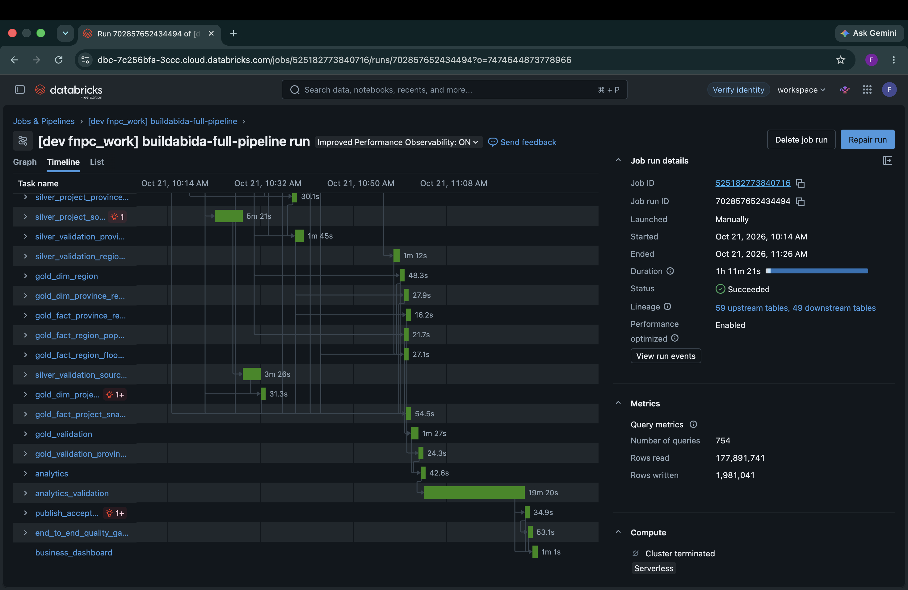
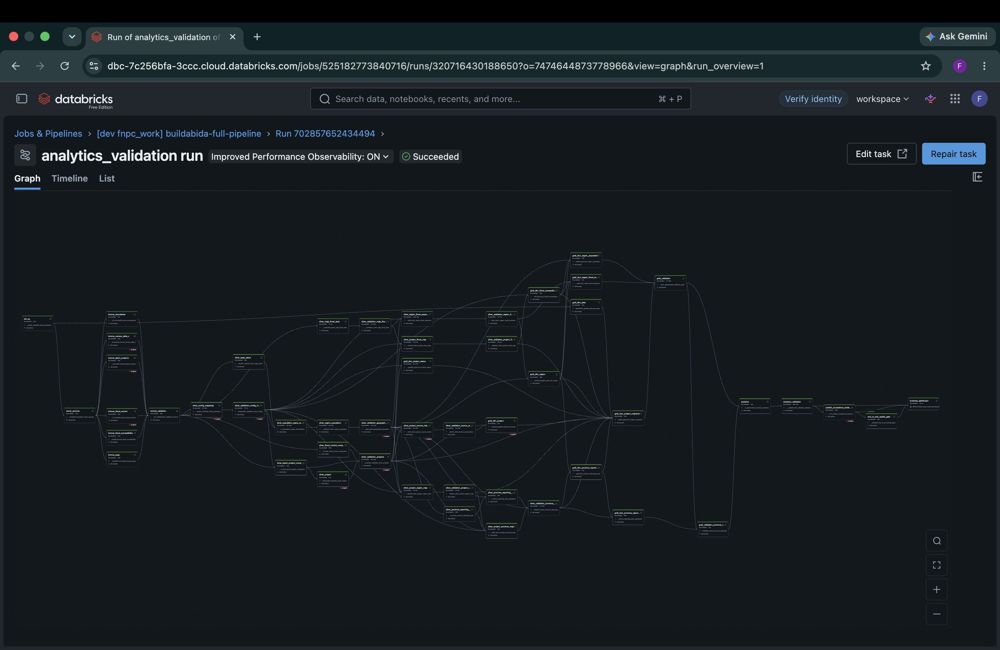
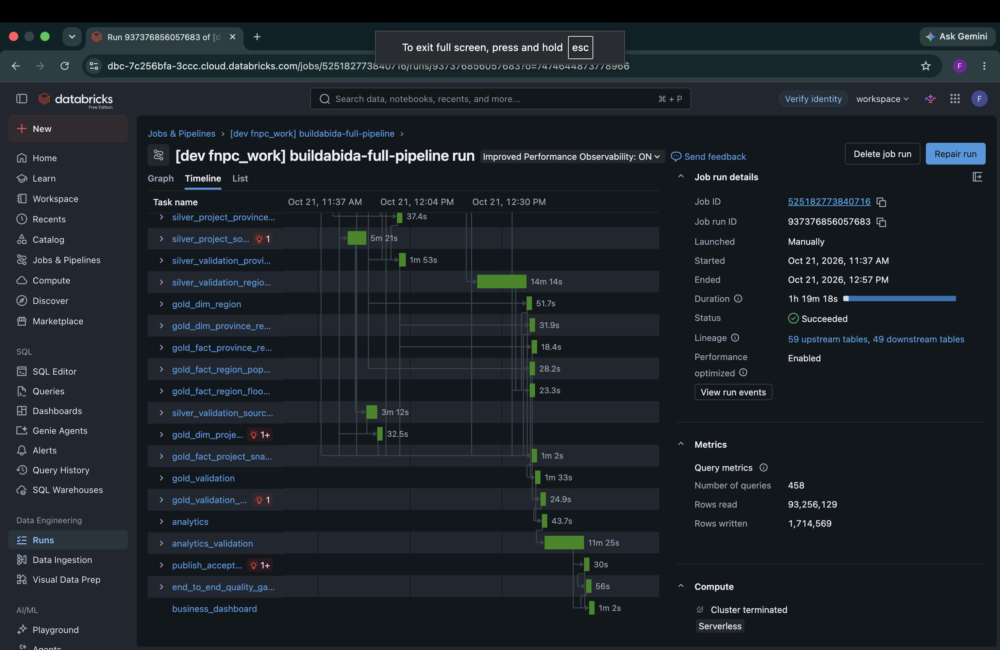
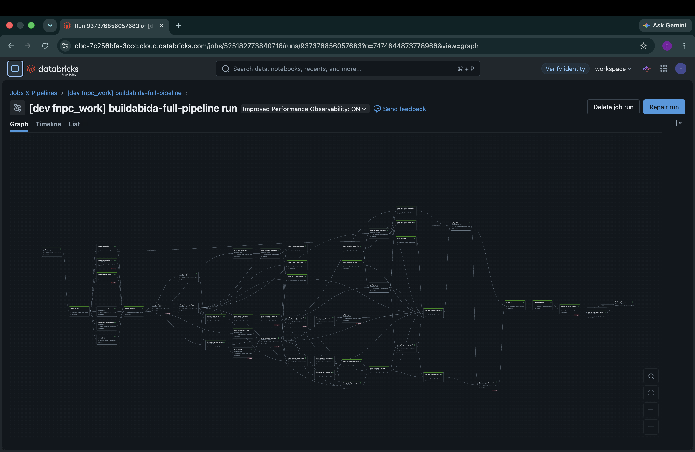
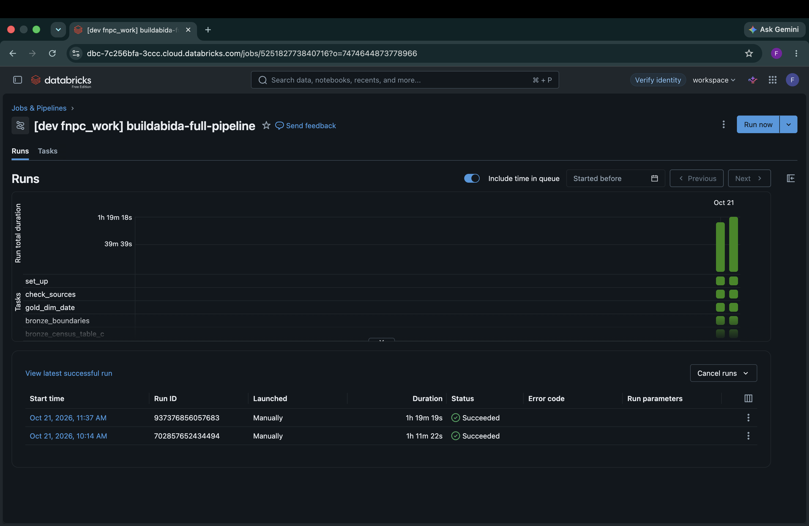

# Dev bundle and clean-workspace evidence: October 21, 2026

This evidence records a Databricks Asset Bundle deployment and two complete
runs in a separate Databricks Free Edition workspace. It closes the earlier
gap between the manually created team job and the bundle-managed development
job.

## Run identity

| Field | Value |
| --- | --- |
| Bundle target | `dev` |
| Job | `[dev fnpc_work] buildabida-full-pipeline` |
| Job ID | `525182773840716` |
| First job run | `702857652434494` |
| First run window | October 21, 2026, 10:14 AM to 11:26 AM, Asia/Manila |
| Second job run | `937376856057683` |
| Second run window | October 21, 2026, 11:37 AM to 12:57 PM, Asia/Manila |
| Source snapshot | `metadata-6321c7aa6f2a14e12f4c` |
| Repository branch | `feat/productionize-governance` |
| Deployed commit | `b6abb91` with the bundle edits later committed as `f79b9d6`. Confirmed by the tester. See [deployed commit](#deployed-commit) |

Both runs finished with status **Succeeded**. The second run used the same
source snapshot and repeated the same quality-gate counts.

## Deployed commit

The screenshots don't show the commit. The team reconstructed it from the
branch history, and the tester confirmed it. Times are Asia/Manila, from the
commit timestamps.

| Commit | Time | What it shows |
| --- | --- | --- |
| `b6abb91` | Oct 21, 4:25 AM | The last commit on the branch before the first run started at 10:14 AM |
| `f79b9d6` | Oct 21, 11:37 AM | Committed by the tester the same minute the second run started. It changes only deploy settings: it removes the team workspace host from the `dev` target and replaces the `dashboard_id` variable with a fixed dashboard ID that differs from the team default. These are the edits a deploy to a separate workspace needs |
| `f2585ab` | Oct 21, 1:30 PM | Puts the dashboard ID back to the `dashboard_id` variable, so the repository stays workspace-neutral |

The deployed code was `b6abb91` with the edits from `f79b9d6`. The tester
confirmed this. Between `b6abb91` and `f79b9d6`, no notebook, `src`,
or job task changed except one added dependency in `f79b9d6`:
`gold_fact_region_population` now waits for `gold_dim_flood_susceptibility`.

The confirmation came from the tester, not from Databricks metadata. To check it
again, open the deployment metadata that the bundle writes in the tester's
workspace:

```text
/Workspace/Users/<tester>/.bundle/infra-project-monitoring/dev/state/metadata.json
```

Look for the `git` section under `bundle`. It should hold the commit and branch
that were deployed. Record that value here if it differs.

For the next run, record the commit before you deploy:

```bash
git rev-parse --short HEAD
git status --porcelain   # must print nothing, so the deploy matches the commit
```

## Quality-gate result

The attached [quality-gate export](quality-gate-summary.csv) contains six rows
per job run: one row for each layer and one `ALL` row.

| Layer | Gate | Passed | Flagged | Failed STOP | Missing |
| --- | --- | ---: | ---: | ---: | ---: |
| bronze | FLAG | 119 | 7 | 0 | 0 |
| silver | FLAG | 263 | 71 | 0 | 0 |
| gold | FLAG | 90 | 9 | 0 | 0 |
| analytics | FLAG | 90 | 22 | 0 | 0 |
| end_to_end | PASS | 4 | 0 | 0 | 0 |
| **ALL** | **FLAG** | **566** | **109** | **0** | **0** |

`FLAG` is publishable under the governed contract. Known source limitations
remain visible. No STOP check failed, and all required evidence was present.
Matching layer counts show a repeatable result for this snapshot. This export
does not prove that every table-level run ID stayed unchanged. Make that
narrower claim only when the table-level query output is retained.

## Dashboard export

The exact live export supplied with this run is preserved as
[live-dashboard-export.lvdash.json](live-dashboard-export.lvdash.json).
Its SHA-256 is
`6e02f79424861bd79ffddffc1b692dbac8dfffe4ff9358b17becff83e385afae`.

The repository's canonical dashboard export is based on that file, with three
governance corrections before commit:

- six unused Lakeview datasets that read Gold facts directly were removed
- three active support datasets were redirected to the governed Analytics
  views without changing their output column names
- the unqualified Analytics table and long-dash characters were normalized so
  the dashboard contract tests can verify them.

The corrected canonical export passed local static contract tests. It must be
imported and visually checked in Databricks before anyone claims that those
three query rewrites have runtime evidence. The untouched live export above is
the evidence for the dashboard that actually ran.

## Checksums

| Artifact | SHA-256 |
| --- | --- |
| `quality-gate-summary.csv` | `ceb5857015b949878c633097f01fbe5f55da80a24ef315f2cb59d2b523e34187` |
| `live-dashboard-export.lvdash.json` | `6e02f79424861bd79ffddffc1b692dbac8dfffe4ff9358b17becff83e385afae` |
| Canonical repository dashboard | `fd91c9b962ffdf51f30b6df5a56ffebdb524eef4b2bdcb024647f4821b63bee6` |

## Screenshots

The first dev-bundle run succeeded:



The Analytics validation task also succeeded in that run:



The second complete run succeeded:



Its full graph finished green, including the quality gate and dashboard task:



The run history shows both successful executions of the same bundle-managed
job:



## Scope of the proof

This evidence proves development-target bundle deployment, a complete run in a
separate workspace, a successful rerun, quality-gate consistency, and a
successful dashboard task. It does not prove production binding or production
deployment. Those remain controlled post-merge operations.
