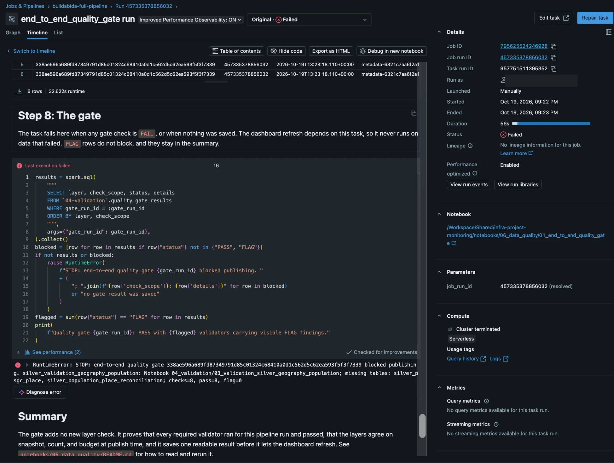
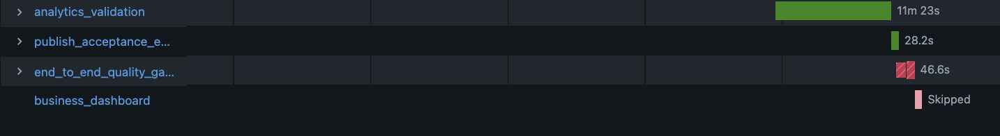
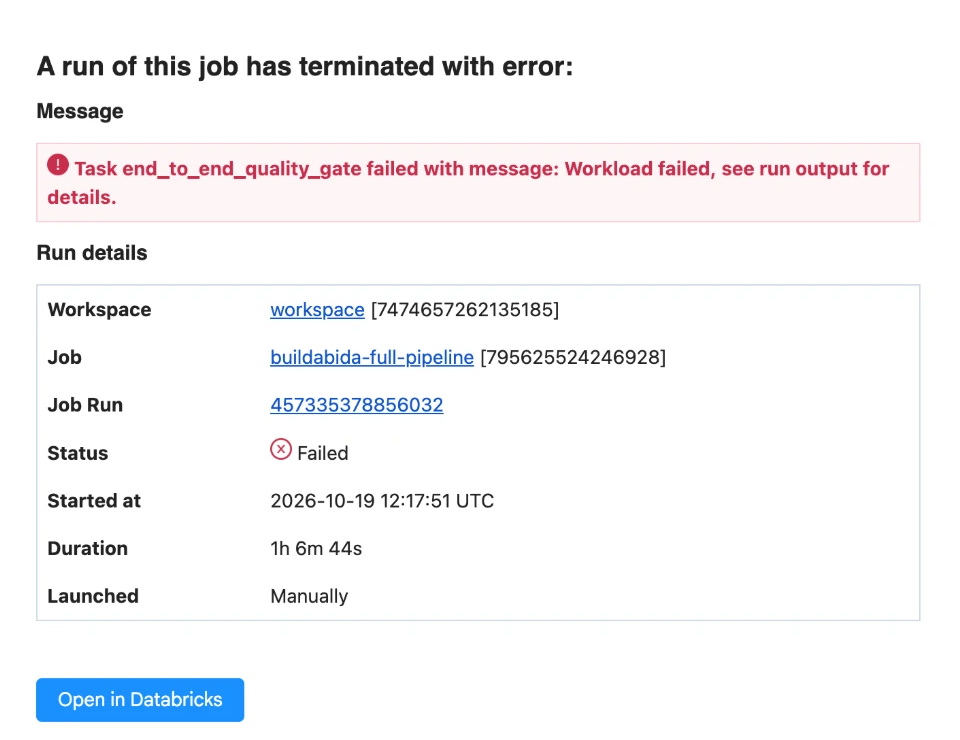
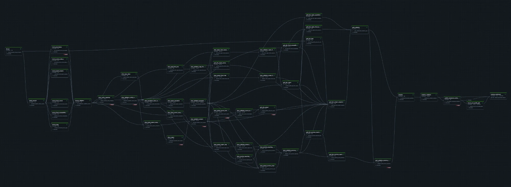
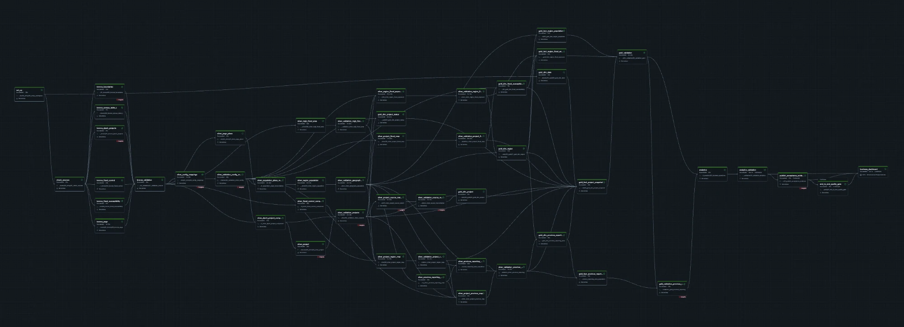

# End-to-end quality gate: first two Databricks runs

The 50-task `buildabida-full-pipeline` job ran in the team workspace on October 19, 2026, with the end-to-end quality gate for the first time. The first attempt stopped at the gate because of a bug in the gate. The fix, a repair, and a passing gate followed in the same job run. A second job run on the same data then gave the same result. This page records what happened and what the gate saw.

| Field | Value |
| --- | --- |
| Job | `buildabida-full-pipeline`, job ID `795625524246928` |
| Job run | `457335378856032`, launched manually |
| Started | 2026-10-19 12:17:51 UTC |
| Branch | `feat/productionize-governance` (pull request #138) |
| DPWH snapshot | `metadata-6321c7aa6f2a14e12f4c` |

## Incident: the gate stopped a good run

| Part | What happened |
| --- | --- |
| Incident | After 1h 6m 44s, `end_to_end_quality_gate` failed and `business_dashboard` was skipped. The failure email arrived. |
| Problem | The gate said `silver_validation_geography_population` was missing `silver_psgc_place` and `silver_population_place_reconciliation`, although its 8 saved checks all passed. The gate grouped each validator's rows by `validation_run_id`, but that validator gives each of its three tables its own run ID. So the gate found only one table under the run ID it looked up. The data was fine. The gate was wrong. |
| Resolution | Commit `adb3a1f` gave all three tables one run ID. A repair then passed. The gate now groups evidence by save time (`run_ts`). Each validator saves its rows once with one timestamp. This supports either run-ID recipe. |
| Prevention | `tests/test_quality_gate.py` now gives each validator its own save time, and gives the geography validator one run ID per table, as real runs do. Three regression tests were added. Against the old gate, two of them fail the same way Databricks did. |

The failure path itself behaved as designed. The gate saved its result before it failed, Databricks skipped the dashboard refresh, and the failure email arrived.

## Gate result after the repair

Saved at 2026-10-19 13:40:22 UTC.

| Layer | Status | Checks | Pass | Flag | Failed STOP | Missing |
| --- | --- | ---: | ---: | ---: | ---: | ---: |
| bronze | FLAG | 126 | 119 | 7 | 0 | 0 |
| silver | FLAG | 334 | 263 | 71 | 0 | 0 |
| gold | FLAG | 99 | 90 | 9 | 0 | 0 |
| analytics | FLAG | 112 | 90 | 22 | 0 | 0 |
| end_to_end | PASS | 4 | 4 | 0 | 0 | 0 |
| **ALL** | **FLAG** | **675** | **566** | **109** | **0** | **0** |

`FLAG` means known data limits, which stay visible. No STOP check failed and no evidence was missing, so the dashboard refreshed.

The check counts match earlier evidence: 126 Bronze checks, 112 Analytics checks, and 99 Gold checks (75 from `09_validation_gold` and 24 from `09a_validation_gold_province_reporting`).

## Totals across layers

| Layer | Projects | Reported budget (pesos) |
| --- | ---: | ---: |
| `02-silver.silver_project` | 265,582 | 6,535,616,688,947.00 |
| `03-gold.fact_project_snapshot`, current rows | 265,582 | 6,535,616,688,947.00 |
| `05-analytics.analytics_implementation_monitoring` | 265,582 | 6,535,616,688,947.00 |

This is the reported project or contract budget, not payment (D-28). The October 12 and 13 Gold evidence had 265,656 current projects. This run has 74 fewer. The difference has not been traced yet. A likely cause is the Bronze multiline CSV fix in #133, but that is not confirmed.

## Rerun on unchanged data

Job run `880939659105900` ran the same job again with no data change. Its gate saved at 2026-10-19 17:08:31 UTC. Each job run saved 17 gate rows, all at one timestamp. The exports are in this folder: [gate runs](gate-runs.csv), [gate summary](gate-summary-run1-run2.csv), [totals](totals-after-run2.csv), and [validator run IDs](validator-run-ids.csv).

| Layer | Run `457335378856032` | Run `880939659105900` |
| --- | --- | --- |
| bronze | FLAG, 126 / 119 / 7 | FLAG, 126 / 119 / 7 |
| silver | FLAG, 334 / 263 / 71 | FLAG, 334 / 263 / 71 |
| gold | FLAG, 99 / 90 / 9 | FLAG, 99 / 90 / 9 |
| analytics | FLAG, 112 / 90 / 22 | FLAG, 112 / 90 / 22 |
| end_to_end | PASS, 4 / 4 / 0 | PASS, 4 / 4 / 0 |
| **ALL** | **FLAG, 675 / 566 / 109** | **FLAG, 675 / 566 / 109** |

The numbers are checks / pass / flag. Both runs had 0 failed STOP checks and 0 missing checks in every layer.

After the second run:

- **Totals did not change.** Silver, current Gold, and Analytics still hold 265,582 projects and 6,535,616,688,947.00 pesos, so the rerun added no duplicates.
- **Run IDs did not change.** Silver `run_id` stays `c6317d2b45b2b3f9832e9dfccf130317fea4d1b06a18922d837d22d449b6a424`, and Gold `run_id` stays `8ade0907b7a642b47dded535a800228b19afe5ba5342a8f09ea5e3b703e4c3ac`.
- **Validator evidence was updated, not copied.** Across both gate runs, each of the 12 Silver, Gold, and Analytics validators has one validation run ID. Bronze has two, one per run, by design. The four cross-layer checks have none, by design.

The geography validator used one run ID for all its tables in both runs, because commit `adb3a1f` stayed in place. So these runs did not exercise the gate with one run ID per table. The regression tests cover that case. After these runs, validation version `silver-geography-population-validation-v5` replaced the `adb3a1f` recipe with one run ID built from all three tables' run IDs (see [validation](../../validation/validation.md)). The next job run creates new geography evidence rows under the new ID, and the old rows stay as history.

The queries used are the gate summary for the latest gate run, the row counts and budget sums per layer, and `COUNT(DISTINCT evidence_validation_run_id)` per `check_scope` in `quality_gate_results`.

## Screenshots

The failure on the first attempt of job run `457335378856032`. The gate saved its result, then failed with the reason. The account name is hidden.

Because the gate failed, Databricks skipped the dashboard refresh.

The failure email arrived for the same job run.

After the fix and **Repair run**, every task of job run `457335378856032` succeeded.

The rerun on unchanged data, job run `880939659105900`, also succeeded on every task.

